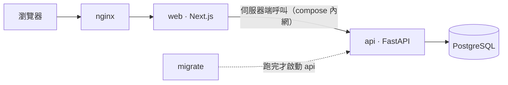

# Flower Luxury

精品商品與交易管理系統，供店長與員工共用品牌、廠商、商品照片、詢價與成交記錄。
以 FastAPI + Next.js 建置，支援中英雙語與手機操作；功能以模組劃分，模組邊界由測試強制執行。

## Quickstart

需要 Docker Desktop、`make`、`openssl`、`uv` 與 Node（版本見 [`apps/web/.nvmrc`](apps/web/.nvmrc)）。

```bash
make init dev   # 產生 .env（MODE=development，金鑰自動產生）並安裝相依
make start      # 啟動開發環境（首次建置約 2–5 分鐘）
```

環境啟動後執行 `make db superuser` 建立第一位店長，再開啟 `http://localhost:{SYSTEM_PORT}`
（預設 3000）登入。店長可在管理區設定共用註冊碼，讓持有有效碼者從 `/signup` 註冊店長；
員工由店長在使用者管理建立。詳細規則見[帳號、角色與密碼](docs/features/accounts-roles.md)及
[店長註冊](docs/features/registration.md)。

## 包含什麼

| | |
|---|---|
| 後端 | FastAPI、SQLAlchemy 2.1 async、Alembic、Python 3.14；pytest、ruff、mypy |
| 前端 | Next.js 16、React 19、TypeScript、CSS Modules；Vitest、ESLint、knip |
| 基礎設施 | Node.js 24、PostgreSQL 17、Docker Compose（dev／prod）、nginx、GitHub Actions |
| 功能 | JWT 認證、店長／員工、共用註冊碼、Session 撤銷、登入及註冊限流、游標分頁 |
| 業務功能 | 共用品牌與廠商、店長匯率設定、商品建檔與照片、詢價、成交快照、帶原因退回與再次成交 |
| 前後端契約 | 後端產生 OpenAPI → 前端型別，端點、權限、語系寫錯都是編譯錯誤 |
| i18n | 前後端一致的中英雙語，漏翻譯會編譯失敗 |

相依版本以後端 [`pyproject.toml`](apps/api/pyproject.toml) 與 [`uv.lock`](apps/api/uv.lock)、
前端 [`package.json`](apps/web/package.json) 與 [`package-lock.json`](apps/web/package-lock.json)
為準；Node.js 版本線見 [`.nvmrc`](apps/web/.nvmrc)，容器版本見
[`docker-compose.yml`](infra/docker/docker-compose.yml)。

店長可管理員工、註冊碼與匯率；員工可操作商品、照片與交易。所有登入者共用業務資料，沒有多店資料隔離。
照片支援 JPEG、PNG、WebP、HEIC，保留原檔並提供需登入的下載；已出售商品唯讀，退回後可再次成交，
過去成交快照與退回原因持續保留。

## 架構

```text
app（組裝層） → modules（垂直功能） → shared（平台能力）
```

- **每個功能是一個模組**，前後端同名，各自擁有路由、資料表、權限、畫面與測試。
- **跨模組只走 public entry**，由 import-linter（後端）與 dependency-cruiser（前端）強制執行。
- **測試與原始碼同構**：`tests/modules/users/` 對 `modules/users/`。



瀏覽器經 nginx 存取系統；業務 API 由 Next.js 在 compose 內網呼叫。
照片顯示與原圖下載另外經 nginx 轉送至 API，仍由後端驗證 Session。

## 文件

| | |
|---|---|
| [`AGENTS.md`](AGENTS.md) | 給 AI agent 的規則與陷阱 |
| [`docs/architecture.md`](docs/architecture.md) | 依賴規則、模組介面、目錄結構、前後端契約 |
| [`docs/development.md`](docs/development.md) | 指令、測試策略、程式碼風格、CI |
| [`docs/features/`](docs/features/README.md) | 帳號與註冊、Session、品牌與廠商、商品照片、詢價與成交等功能規則 |
| [`docs/extending.md`](docs/extending.md) | 擴充系統：新增模組、權限、migration、語系 |
| [`docs/operations.md`](docs/operations.md) | 部署、主機設定、備份與救援 |
| [`docs/decisions/`](docs/decisions/README.md) | 設計決策（ADR）：刻意不採用主流做法的地方與理由 |

## 移植狀態

店長／員工、共用註冊碼、品牌與廠商、匯率、商品、照片及交易功能已移植。
員工從建商品、上傳照片、詢價到成交、退回與再成交，已有[單一完整 E2E](e2e/tests/product-lifecycle.spec.ts)
驗證同一商品的照片、原圖下載、操作限制、成交快照與流向記錄。
另有[英文完整操作與公開實拍 HEIC E2E](e2e/tests/english-acceptance.spec.ts)，
驗證語系切換、前後端英文錯誤、照片補傳、顯示圖及原圖下載。
[iPhone Safari 原生相機、系統選檔與下載](docs/acceptance/iphone-safari.md)仍待實機驗收。

舊資料與照片搬移、正式發版與部署另案處理。主機設定確認及備份還原演練也尚未完成；
現有操作文件見[部署與維運](docs/operations.md)，功能變更見[變更紀錄](CHANGELOG.md)。
